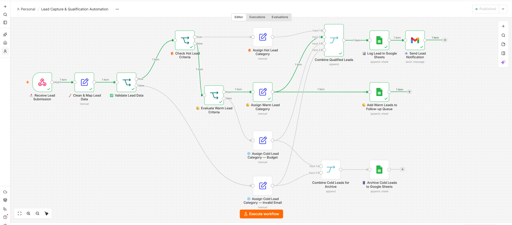
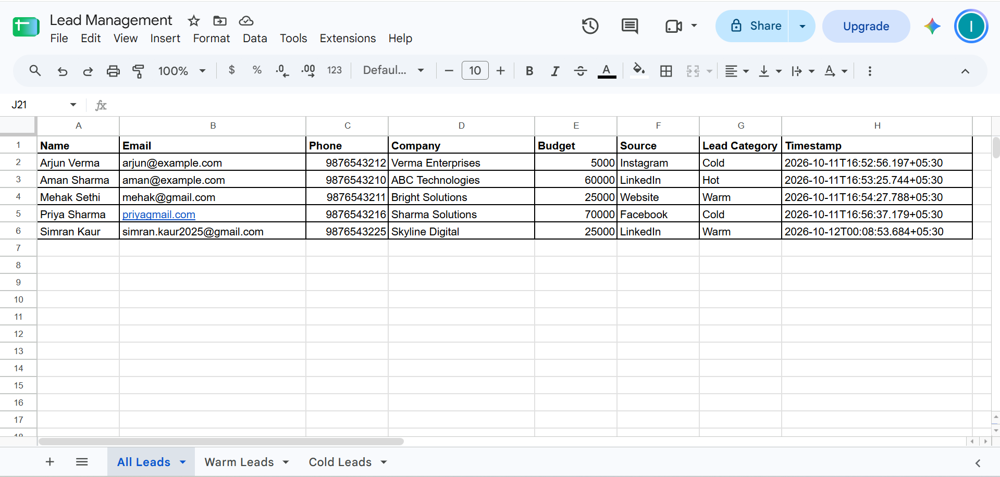
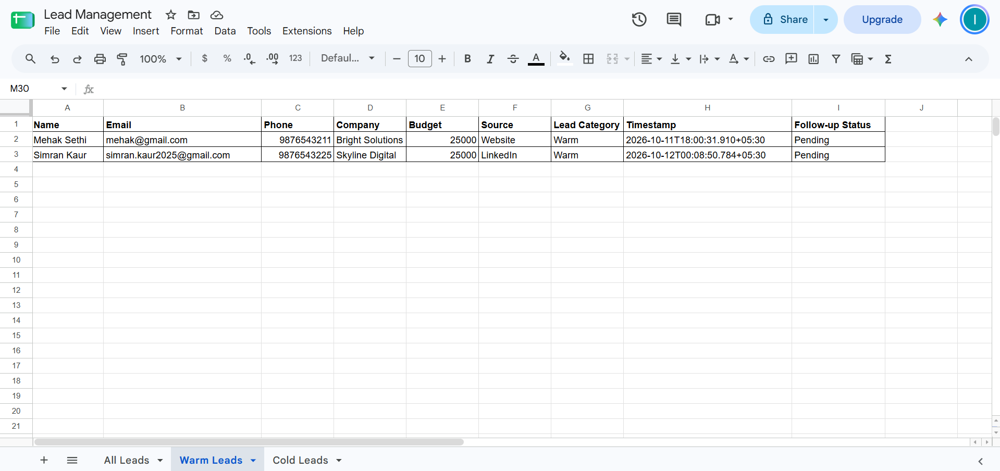
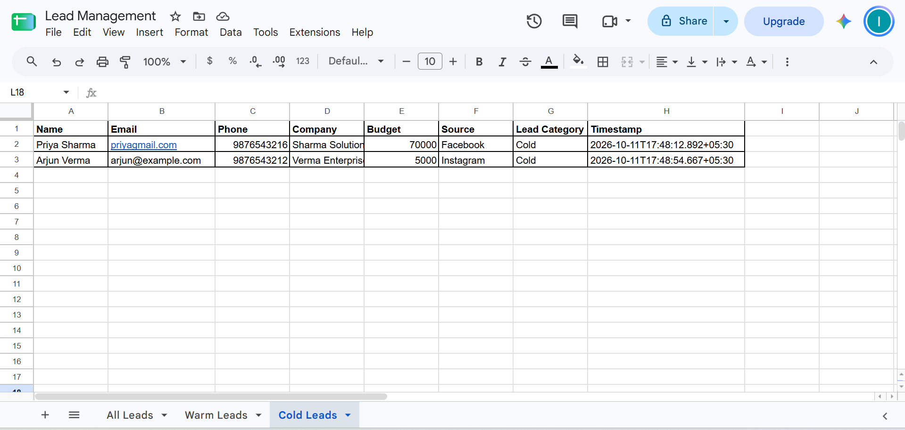
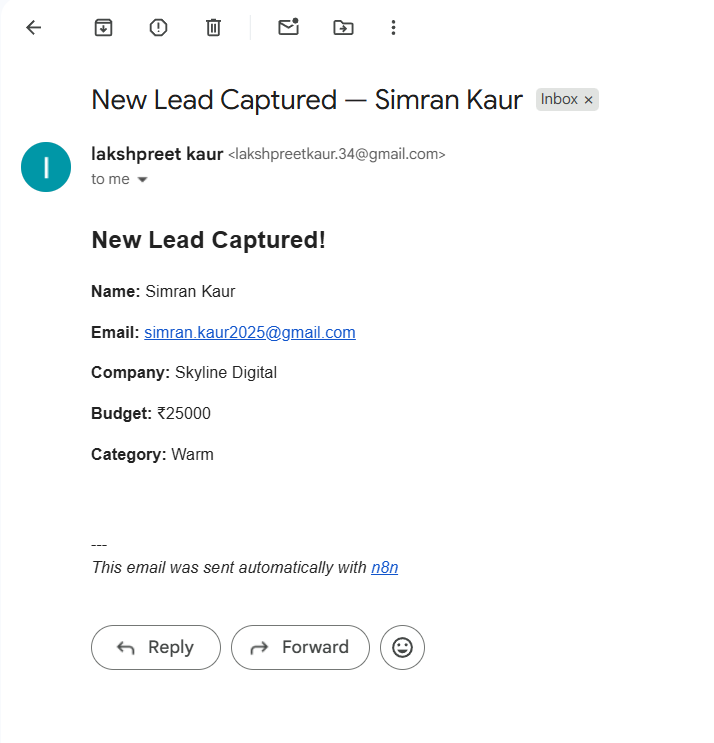

# Lead Capture & Qualification Automation

An n8n automation workflow that captures lead submissions, validates email formats, classifies leads into Hot, Warm, and Cold categories, stores lead data in Google Sheets, and sends Gmail notifications.

## 📸 Workflow Screenshots

### 1. Complete Workflow

### 2. All Leads – Google Sheets
Stores leads from all categories, including their contact details, budget, source, category, and timestamp.

### 3. Warm Leads – Follow-up Queue
Stores Warm leads separately and assigns an initial follow-up status of `Pending`.

### 4. Cold Leads – Archive
Stores Cold leads separately for tracking and review.

### 5. Gmail Lead Notification
Sends an email notification containing the lead's details and assigned category after the lead is logged in the All Leads sheet.

## ⚙️ Workflow Features

- **Webhook Integration:** Receives lead submissions through an HTTP POST webhook.
- **Data Mapping:** Organizes incoming fields such as name, email, phone, company, budget, and source.
- **Email Validation:** Checks the email format before applying budget-based classification.
- **Lead Classification:** Automatically assigns Hot, Warm, or Cold categories.
- **Google Sheets Integration:** Stores all leads in the All Leads sheet.
- **Warm Lead Management:** Stores Warm leads in a separate sheet with a Pending follow-up status.
- **Cold Lead Archiving:** Stores Cold leads in a separate sheet.
- **Gmail Notifications:** Sends lead details and category through email.

## 🔥 Lead Classification Rules

| Category | Condition |
|---|---|
| Hot | Budget is ₹50,000 or more |
| Warm | Budget is ₹10,000 or more but below ₹50,000 |
| Cold | Budget is below ₹10,000 or the email format is invalid |

## 🔄 How It Works

1. A lead submission reaches the n8n webhook.
2. Incoming lead fields are mapped and organized.
3. The email format is validated.
4. The workflow checks the budget and assigns a lead category.
5. All leads are stored in the All Leads Google Sheet.
6. Warm leads are additionally stored in the Warm Leads sheet.
7. Cold leads are additionally stored in the Cold Leads sheet.
8. A Gmail notification is sent after the All Leads logging step.

## 🛠️ Tools & Technologies

- [n8n](https://n8n.io/) – Workflow automation
- Google Sheets – Lead storage and tracking
- Gmail – Email notifications
- Webhooks – Lead submission intake

## 🚀 Setup

1. Download or clone this repository.
2. Import `lead-capture-qualification.json` into your n8n instance.
3. Configure your Google Sheets and Gmail credentials in n8n.
4. Select your Google Sheets document and the correct worksheet tabs.
5. Configure the webhook to receive the expected fields: `name`, `email`, `phone`, `company`, `budget`, and `source`.
6. Test Hot, Warm, Cold, and invalid-email submissions before using the workflow.

---

**Project:** Lead Capture & Qualification Automation  
**Built with:** n8n, Google Sheets, Gmail, and Webhooks
